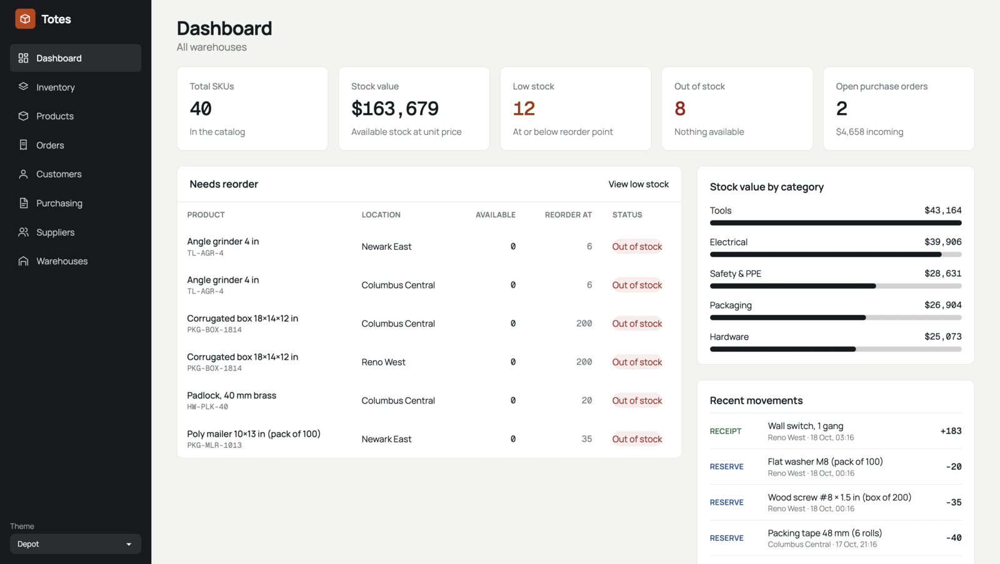
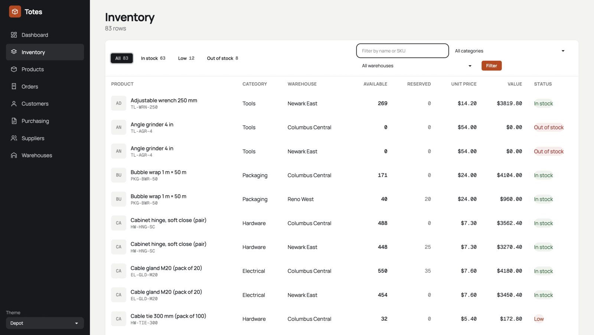
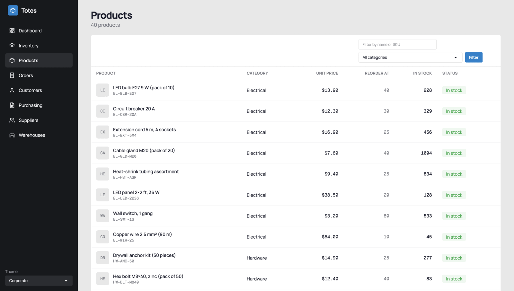
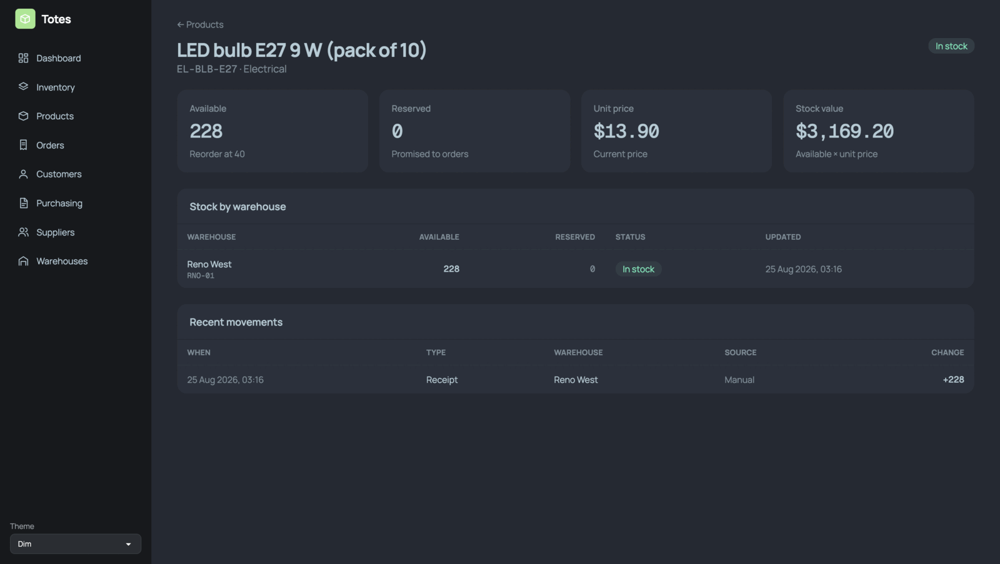
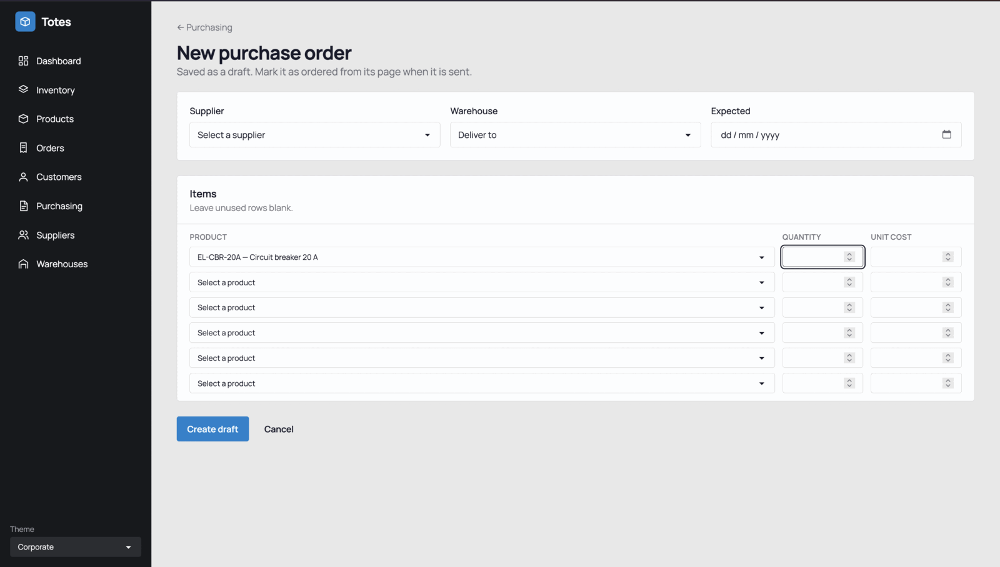
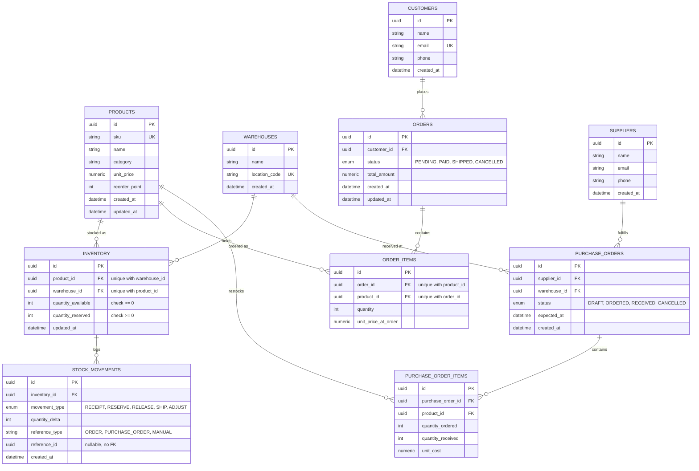

# Totes

Inventory management for warehouses, built with Django. Products, stock per
warehouse, customers and sales orders, suppliers and purchase orders, all
tied to an auditable stock ledger.

<p align="center">
  
  
  
</p>
<p align="center">
  
  
</p>

## Stack

- Python 3.14, [uv](https://docs.astral.sh/uv/), Django 6.1
- Postgres (Supabase) via `DATABASE_URL` in `.env`; sqlite when it is unset
- Server-rendered Django templates, [daisyUI](https://daisyui.com/) +
  Tailwind (standalone binary, no Node.js), self-hosted Manrope / Geist Mono
- Themes (Nord default, Corporate, Emerald, Winter, Dim, Depot) with a
  picker in the sidebar; mobile layout with a collapsible menu

## Getting started

```
make install            # uv sync
make css-install        # download tailwindcss + daisyUI (one-time)
cp .env.example .env    # set DATABASE_URL, or skip to use sqlite
make migrate
make superuser          # admin login for /admin/
make seed               # demo data (see below)
make run                # http://127.0.0.1:8000/
```

`make help` lists the rest. After changing templates or
`static/css/input.css`, run `make css-build` (or `make css-watch`) and commit
the regenerated `static/css/output.css`; it is committed so deploys don't
build it. `make test` always runs on sqlite.

## Demo data

`make seed` fills an empty database with 3 warehouses, 40 products, stock,
customers, suppliers, orders and purchase orders. It is deterministic, keeps
the stock ledger consistent, and refuses to run on a database that already
has data. `make reseed` wipes the domain data (users are kept) and reseeds,
after asking; `uv run python manage.py seed_demo --reset --yes` skips the
prompt. The command lives in `config/management/commands/seed_demo.py`.

## Apps and pages

One Django app per domain concept, each with models, admin, views, urls and
templates. The dashboard (`/`) lives in `config`.

| App          | Models                               | Pages                                   |
| ------------ | ------------------------------------ | --------------------------------------- |
| `products`   | `Product`                            | list, detail                            |
| `warehouses` | `Warehouse`                          | list                                    |
| `inventory`  | `Inventory`, `StockMovement`         | list (status tabs, filters)             |
| `customers`  | `Customer`                           | list                                    |
| `orders`     | `Order`, `OrderItem`                 | list, detail, new                       |
| `suppliers`  | `Supplier`                           | list                                    |
| `purchasing` | `PurchaseOrder`, `PurchaseOrderItem` | list, detail, new, edit (drafts)        |

Conventions:

- Plural app names (`inventory` stays singular, a mass noun); UUID primary keys.
- Views `<model>_<action>`, URL names `<model>-<action>`, templates in
  `<app>/templates/<app>/<action>.html`.
- `TextChoices` for statuses; relative imports inside an app, absolute across apps.

## Workflows

Stock only changes through code that also writes the `StockMovement` ledger,
so every counter can be explained from history.

**Orders** (`orders/services.py`)

- *New order* creates a `PENDING` order and reserves stock from the
  warehouses holding the most first (`RESERVE` rows: units move from
  available to reserved).
- `PENDING` → `PAID` or `CANCELLED`; `PAID` → `SHIPPED` or `CANCELLED`.
  Anything else is rejected.
- Shipping clears the reservation with a `SHIP` row of delta 0 (reserving
  already took the units out of available). Cancelling returns them with
  `RELEASE` rows.

**Purchase orders** (`purchasing/services.py`)

- New POs are saved as `DRAFT`; only drafts can be edited.
- `DRAFT` → `ORDERED` or `CANCELLED`; `ORDERED` → `CANCELLED` while nothing
  has been received.
- On an ordered PO, *Receive now* books units per line into the PO's
  warehouse (`RECEIPT` rows; the inventory row is created if needed).
  Partial receipts are fine, and the PO becomes `RECEIVED` once every line
  is complete.

## Data model



Design decisions:

- **Real foreign keys and DB constraints.** `Inventory` is unique on
  `(product, warehouse)`; quantities can't go negative; statuses are enums.
- **Append-only ledger.** Every change to `quantity_available` or
  `quantity_reserved` has a `StockMovement`, so counters can be checked
  against history. A mistake is fixed with a new `ADJUST` row, never an edit.
  `reference_type` / `reference_id` point at the source without a foreign
  key, so `inventory` doesn't depend on the order apps.
- **Frozen prices.** `OrderItem.unit_price_at_order` keeps what was charged
  when `Product.unit_price` changes later.
- **Inbound mirrors outbound.** `Supplier` → `PurchaseOrder` →
  `PurchaseOrderItem` has the same shape as `Order` / `OrderItem`.
- **Low stock** means total available at or below `Product.reorder_point`.

## Deploying to Vercel

Vercel detects the project from `manage.py` and runs the app as one function;
the database stays on Supabase.

1. Run `make css-build`, commit `static/css/output.css`, push to GitHub.
2. Import the repo at vercel.com (framework: Django, no build command).
   `collectstatic` runs on deploy.
3. Set environment variables (see `.env.example`): `DATABASE_URL` (Supabase
   **transaction pooler**, port 6543) and `SECRET_KEY` (required when
   `DEBUG` is off, which is the default on Vercel). `ALLOWED_HOSTS` and
   `CSRF_TRUSTED_ORIGINS` only for a custom domain; `*.vercel.app` is always
   allowed.
4. Migrations don't run on deploy: run `make migrate` locally with
   `DATABASE_URL` set, and create the admin login with `make superuser`.

## Still to do

- **Auth.** Nothing requires a login yet; add login and permissions (who can
  adjust stock, approve POs) before the site is public.
- **Create/edit forms** for products, warehouses, customers and suppliers
  (admin only for now).
- **Dashboard:** warehouse filter and search, a "Reorder" button that drafts
  a PO for low-stock products; decide on Export CSV and Scan barcode.
- **Stock adjustments:** a page that writes the `ADJUST` movement and the
  counter together (adding a movement in the admin doesn't update the
  counter).
- **Cleanups:** `Inventory` shows as "Inventorys" in the admin;
  `Product.unit_price >= 0` constraint; maybe a `Category` model instead of
  free-text categories; tests for `products` and for the model constraints;
  keep `seed_demo` in step with model changes.
- **Deploy leftovers:** `check --deploy` still reports the console mail
  backend (`mail.E001`) and the HSTS / SSL-redirect warnings; harmless now,
  decide before going public. An API layer only if something outside the web
  UI needs one.
