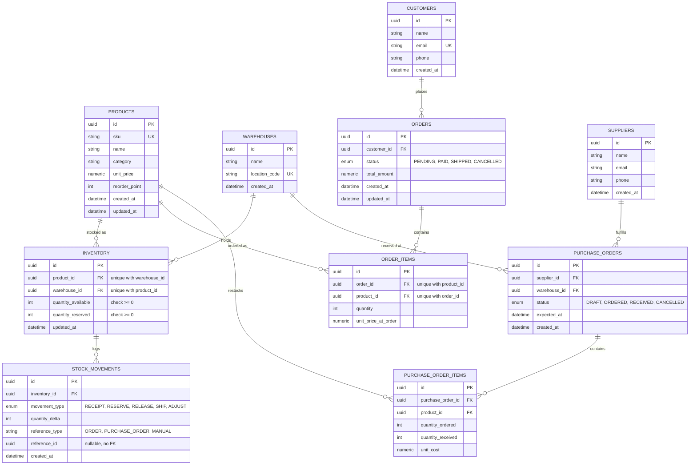

# Totes — Data Schema

This document describes the data model, which models are built, how the
models are grouped into Django apps, and how people move through the system.

Models marked **built** exist in the Django code today. Models marked
**todo** are part of the model but not yet implemented (see `TODO.md`).

## Schema

## Apps and build status

Each domain concept is its own Django app. A parent and its line items live
together (`Order` + `OrderItem`), and the ledger lives with the thing it
audits (`StockMovement` with `Inventory`).

| App          | Models                               | Status |
| ------------ | ------------------------------------ | ------ |
| `products`   | `Product`                            | built  |
| `warehouses` | `Warehouse`                          | built  |
| `inventory`  | `Inventory`, `StockMovement`         | built  |
| `customers`  | `Customer`                           | built  |
| `orders`     | `Order`, `OrderItem`                 | built  |
| `suppliers`  | `Supplier`                           | built  |
| `purchasing` | `PurchaseOrder`, `PurchaseOrderItem` | built  |

That is all 10 models built, across all 7 apps. The remaining work is
business logic and UI (see `TODO.md`).

Dependencies between apps:

- `orders` depends on `customers` and `products`.
- `purchasing` depends on `suppliers`, `warehouses` and `products`.
- `inventory` depends only on `products` and `warehouses`. `StockMovement`
  points at its source (an order, a purchase order, or a manual change)
  through the plain `reference_type` / `reference_id` columns instead of a
  foreign key. This keeps `inventory` independent of the order apps, so both
  order flows can write to the ledger without a circular dependency.

## Design decisions

- **Real foreign keys.** Relationships between models are enforced in the
  database, including `Inventory.warehouse` and `Order.customer`.
- **No duplicate stock rows.** `Inventory` is unique on
  `(product, warehouse)`, so stock for one product in one warehouse lives in
  one row.
- **Quantities can't go negative.** Check constraints on both quantity
  columns enforce this in the database, not just in application code.
- **Status fields are enums.** `Order.status` and `PurchaseOrder.status`
  are restricted to a fixed set of values.
- **Stock changes are auditable.** `StockMovement` is an append-only ledger.
  Every change to `quantity_available` or `quantity_reserved` should have a
  matching row, so the counters can be checked against history.
- **Prices are frozen.** `Product.unit_price` is the current price.
  `OrderItem.unit_price_at_order` records what was actually charged, so a
  later price change doesn't rewrite past orders.
- **Inbound stock is modeled.** `Supplier` → `PurchaseOrder` →
  `PurchaseOrderItem` mirrors the outbound `Order` / `OrderItem` shape, so
  there is a way to represent how inventory gets replenished.
- **Changes are traceable.** `updated_at` is on `Product` and `Inventory`
  (built) and `Order` (built).
- **Low-stock hook.** `Product.reorder_point` is the threshold for
  low-stock alerts.

## Journeys

The same data looks different depending on who is using it. Each journey
below follows one role through the models. Steps that depend on todo apps are
marked.

### Warehouse staff: receiving and adjusting stock

Staff work in one warehouse and care about what is physically on the shelf.

1. They open `/inventory/` and find the `Inventory` row for a product in
   their warehouse. Each row shows `quantity_available` (free to sell) and
   `quantity_reserved` (promised to orders, still on the shelf).
2. A delivery arrives. They match it to a `PurchaseOrder` marked `ORDERED`
   and enter how much of each `PurchaseOrderItem` actually arrived, which
   updates `quantity_received`. _(built: the "Receive now" form on the
   purchase order page; partial receipts are allowed)_
3. Receiving adds to `quantity_available` and writes a `RECEIPT`
   `StockMovement` with `reference_type = PURCHASE_ORDER`. If the product has
   no `Inventory` row in that warehouse yet, one is created first.
4. When a physical count disagrees with the system, they make a manual
   correction. _(not built as a page yet; the admin can add a movement but
   does not update the counter)_ It writes an `ADJUST` movement with `reference_type = MANUAL`
   and a signed `quantity_delta`, so the correction and its size stay on
   record.

### Sales and fulfilment: orders from placement to shipment

This follows one customer order through `Order.status`. _(built: the new
order form at `/orders/new/` and the status buttons on the order page)_

1. A `Customer` places an `Order` (`PENDING`) with one `OrderItem` per
   product. Each item copies `Product.unit_price` into `unit_price_at_order`,
   and `Order.total_amount` is the sum.
2. The system reserves stock. For each item it moves quantity from
   `quantity_available` to `quantity_reserved` on an `Inventory` row that has
   enough, and writes a `RESERVE` movement referencing the order. If no
   warehouse has enough, the order cannot be placed.
3. Payment moves the order to `PAID`.
4. Staff pick and ship. Shipping reduces `quantity_reserved` and writes a
   `SHIP` movement with a delta of 0 (reserving already took the units out of
   `quantity_available`, and the ledger sums `quantity_delta` into that
   counter). The order moves to `SHIPPED`.
5. If the order is cancelled before shipping, a `RELEASE` movement returns the
   reserved quantity to `quantity_available` and the order becomes
   `CANCELLED`.

Status changes are checked on the server, so an order can't jump from
`CANCELLED` to `SHIPPED`.

### Purchasing: keeping shelves stocked

The purchasing role works from what is running low rather than from what has
arrived. _(partly built: the dashboard lists products that need reorder and
the PO page handles ordering and receiving; there is no form to create a
purchase order yet)_

1. They look for products where total available stock across warehouses has
   fallen to `Product.reorder_point` or below.
2. For each one they pick a `Supplier` and create a `PurchaseOrder` in
   `DRAFT` _(todo: for now in the admin)_ for a target `Warehouse`, with one `PurchaseOrderItem` per product
   giving `quantity_ordered` and `unit_cost`.
3. Sending it to the supplier moves it to `ORDERED`, with an `expected_at`
   date.
4. As the delivery is received (see the warehouse journey), items fill in
   `quantity_received`. When everything is in, the order becomes `RECEIVED`.
   An order that is called off becomes `CANCELLED`.

### Catalog and setup: defining what exists

Before anything moves, someone has to describe the products and places.

1. They add `Product` records with a unique `sku`, a `category`, a
   `unit_price` and a `reorder_point` (`/products/`, or the admin).
2. They add `Warehouse` records with a unique `location_code`
   (`/warehouses/`, or the admin).
3. Creating an `Inventory` row for a product in a warehouse starts tracking
   stock there. The unique constraint means this can only be done once per
   pair.

All of this is available today in the Django admin, and the list pages are
read-only views of the same data.

### Management and audit: asking what happened

This role reads history instead of changing it.

- **Why is this number what it is?** Open an `Inventory` row and read its
  `movements` in time order. Summing `quantity_delta` should explain the
  current counters.
- **What did this order do to stock?** Filter `StockMovement` by
  `reference_type = ORDER` and the order's id.
- **Where did this delivery go?** Filter by `reference_type = PURCHASE_ORDER`
  and the purchase order's id.
- **What did we charge, versus what is the price today?** Compare
  `OrderItem.unit_price_at_order` with `Product.unit_price`.

The ledger is append-only, so these answers don't change after the fact. A
mistake is fixed by writing a new `ADJUST` row, not by editing an old one.

### Current limitations

The ledger is written by the order and purchase order flows, so the audit
journey works for those. One gap remains: adding a `StockMovement` in the
admin does not update the `Inventory` counter, so manual adjustments should
go through code that writes both.
